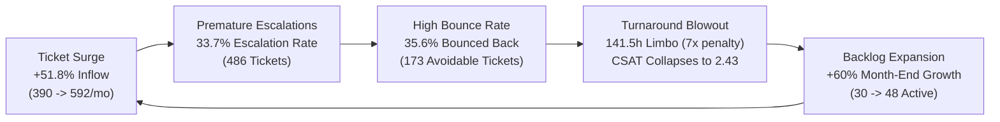
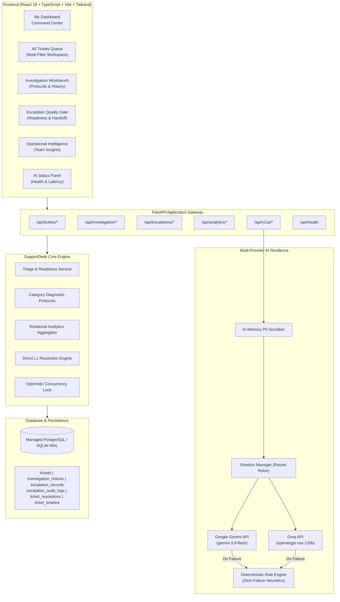
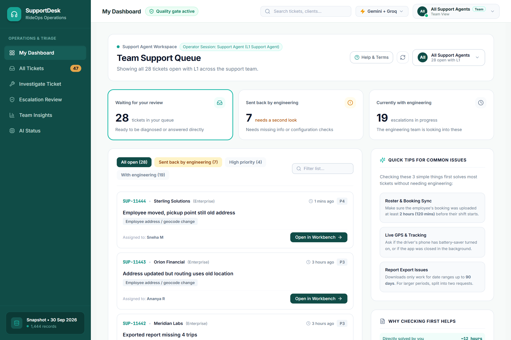
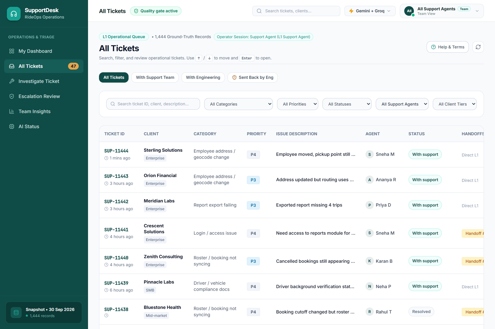
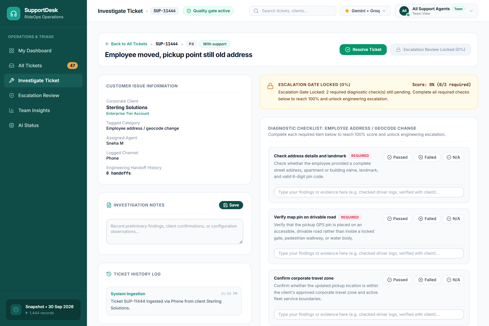
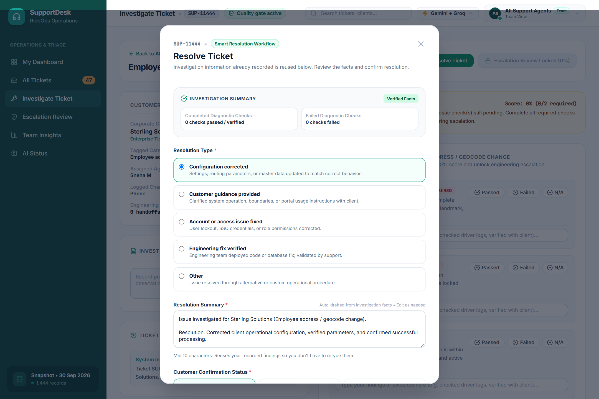
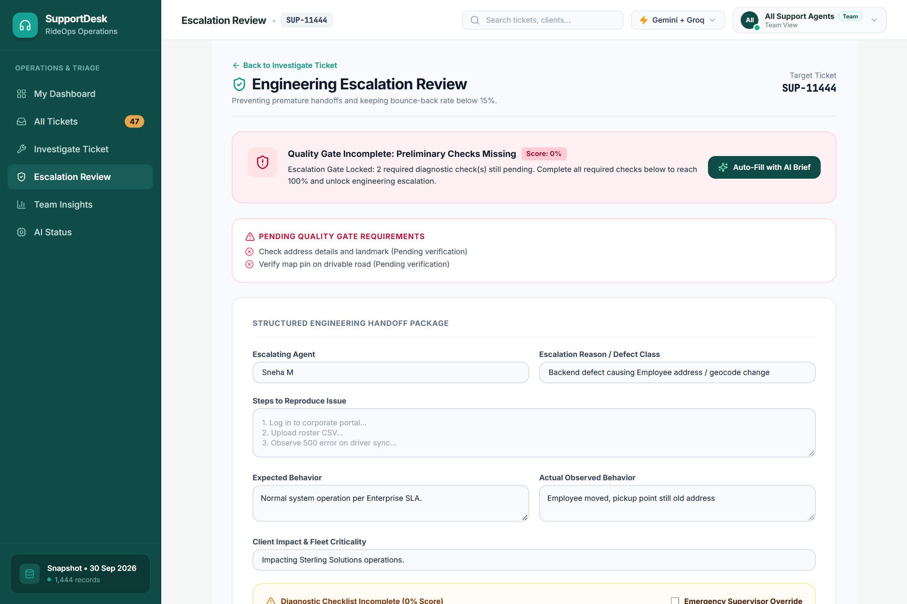
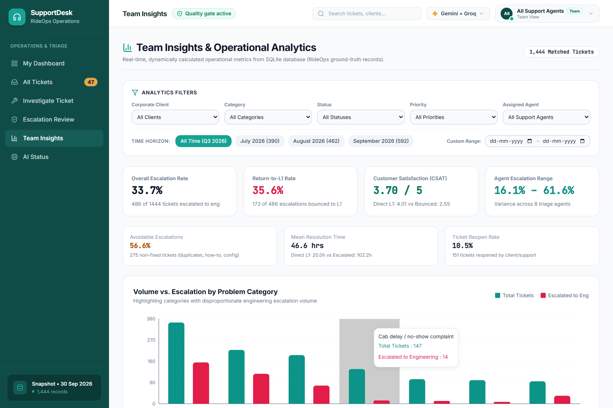
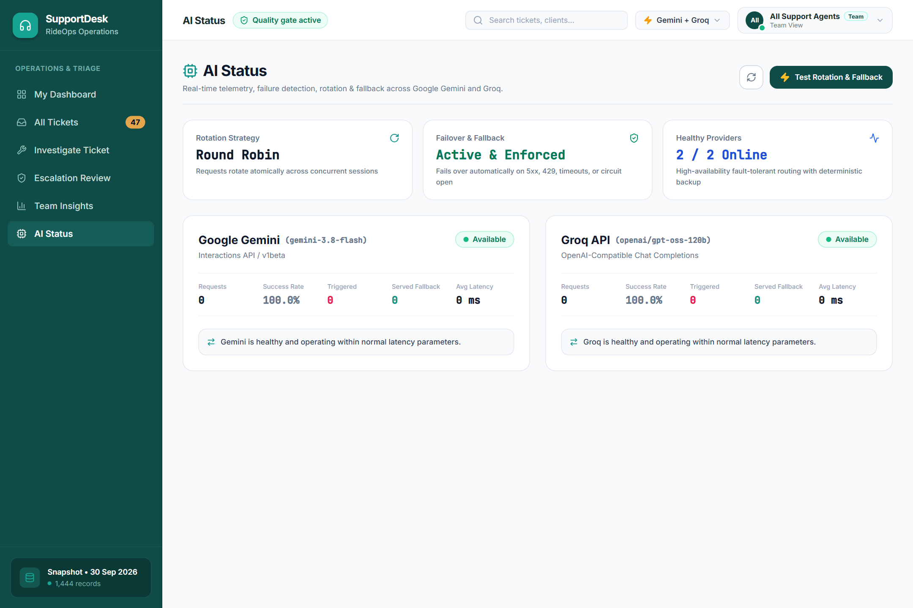

# SupportDesk — RideOps Support Operations & Diagnostic Platform

> **Investigate Faster. Resolve Smarter. Support Better.**

SupportDesk is an intelligent support operations platform and diagnostic workbench engineered for **RideOps Fleet Operations**. It streamlines L1 issue investigation, enforces an objective Escalation Quality Gate to eliminate avoidable Tier 2 escalations, enables structured direct Tier 1 resolutions, and provides comprehensive operational intelligence backed by a 1,444-ticket ground-truth dataset.

---

## 🌐 Live Production Deployments

- **Live Web Application (Frontend):** [https://supportdesk-frontend-ecgs.onrender.com/](https://supportdesk-frontend-ecgs.onrender.com/)
- **Live API Gateway (Backend):** [https://supportdesk-backend-ypdr.onrender.com/](https://supportdesk-backend-ypdr.onrender.com/)
- **Interactive OpenAPI Documentation:** [https://supportdesk-backend-ypdr.onrender.com/docs](https://supportdesk-backend-ypdr.onrender.com/docs)
- **Production Healthcheck:** [https://supportdesk-backend-ypdr.onrender.com/api/health](https://supportdesk-backend-ypdr.onrender.com/api/health)

[](backend/tests/)
[](https://www.python.org/)
[](https://fastapi.tiangolo.com/)
[](https://react.dev/)
[](https://tailwindcss.com/)
[](backend/Dockerfile)
[](render.yaml)
[](#5-multi-provider-ai-copilot-resilience)

---

## 📚 Complete Project Documentation Suite

All architectural decisions, schemas, APIs, manuals, and requirement mappings are documented in the `docs/` repository directory:

| Document | Description |
| :--- | :--- |
| **[PROJECT_OVERVIEW.md](docs/PROJECT_OVERVIEW.md)** | Executive briefing, stakeholder conflicts (Meera, Sandeep, Ritika), baseline problem framing, and strategic solution. |
| **[ARCHITECTURE.md](docs/ARCHITECTURE.md)** | System topology, Mermaid workflow diagrams, state machines, and sequence flows. |
| **[DATABASE.md](docs/DATABASE.md)** | Full schema dictionary, ER diagram, indexing strategy, and optimistic concurrency locking. |
| **[API_REFERENCE.md](docs/API_REFERENCE.md)** | Complete REST endpoint specifications, request/response JSON payloads, and HTTP error codes. |
| **[USER_GUIDE.md](docs/USER_GUIDE.md)** | Step-by-step visual operator manual for L1 support agents with actual production screenshots. |
| **[AI_IMPLEMENTATION.md](docs/AI_IMPLEMENTATION.md)** | Dual-provider (Gemini + Groq) rotation, in-memory PII scrubbing, circuit breakers, and zero-failure heuristics. |
| **[TESTING.md](docs/TESTING.md)** | Automated test suite documentation (22 passing unit/integration tests), chaos tests, and golden dataset invariant checks. |
| **[DEPLOYMENT.md](docs/DEPLOYMENT.md)** | Render PaaS blueprint guide, Docker containerization, and environment variable dictionary. |
| **[REQUIREMENT_MAPPING.md](docs/REQUIREMENT_MAPPING.md)** | Comprehensive 14-point traceability matrix mapping original case study specifications to exact lines of code. |

---

## 1. Business Problem & Ground-Truth Realities (1,444 Tickets)

RideOps manages shift employee transportation for ~200 corporate enterprises. Between July and September 2026, open tickets surged +60%, sparking internal dispute:
- **Meera (Support Lead):** Blamed engineering response times and requested headcount expansion.
- **Sandeep (Engineering Manager):** Argued support escalated tickets without preliminary checks, dumping basic configuration issues onto core developers.
- **Ritika (Head of Operations):** Demanded backlog reduction with **zero budget for new hires**.

### Empirical Data Findings (2 July – 30 September 2026):



| Metric | Database Ground Truth | Impact on Operations |
| :--- | :---: | :--- |
| **Total Inflow Growth** | **+51.79%** (390 in July $\rightarrow$ 592 in Sept) | Massive volume spike without staffing additions. |
| **Quarter-End Backlog** | **30 $\rightarrow$ 48 tickets (+60.0%)** | 29 active with L1 Support, 19 with Tier 2 Engineering. |
| **Tier 2 Escalations** | **486 tickets (33.66%)** | 1 in 3 customer requests was escalated to Engineering. |
| **Escalation Bounce Rate**| **173 tickets (35.60%)** | **Sandeep was right:** 173 tickets bounced (*Configuration Errors* or *Missing Info*). |
| **Avoidable Escalations**| **275 tickets (56.58%)** | Non-software bugs (*Config*, *Missing Info*, *User Guidance*). |
| **Direct L1 Turnaround** | **19.96 hours** (median 12.57h) | Prompt direct fixes protect SLAs and customer satisfaction. |
| **Escalated Turnaround** | **99.79 hours** (~4.1 days) | Escalation multiplies resolution time by 5x. |
| **Bounced Turnaround**   | **141.45 hours** (~5.9 days) | **Meera was right:** Bounced tickets sit in limbo, taking over 7x longer. |
| **Customer CSAT Score** | **4.01/5** (Direct L1) vs **2.43/5** (Bounced) | Escalation bounces severely damage corporate client trust. |
| **Agent Variance**      | **16.1%** (Karan B) to **61.6%** (Rahul T) | Demonstrates urgent need for standardized diagnostic checklists. |

---

## 2. Platform Architecture



---

## 3. Core Feature Walkthrough (With Production Screenshots)

### A. My Dashboard (L1 Operations Command Center)
Highlights active workload, urgent engineering returns, and dynamic backlog counts.


### B. High-Density Search & Multi-Filter Ticket Queue
Allows keyboard navigation, live text search, and filtering by client, category, priority, status, and agent.


### C. Investigation Workbench & Category Protocols
Step-by-step diagnostic checklists tailored per issue category. Prevents premature escalations by guiding agents through configuration checks.


### D. Direct Tier 1 Resolution Workflow
Enables L1 agents to close configuration and access tickets directly, capturing resolution summaries and client confirmation.


### E. Escalation Quality Gate & Structured Engineering Handoff
Enforces a 100% readiness score before tickets can be escalated to Tier 2, requiring standardized reproduction steps, client impact, and evidence.


### F. Team Insights & Agent Escalation Variance
Provides outcome breakdowns, historical trends, and agent performance comparisons (e.g. Karan B at 16.1% vs Rahul T at 61.6%).


### G. AI Provider Health & Status
Real-time latency monitoring, active provider identification, and automated fallback status.


---

## 4. Multi-Provider AI Copilot Resilience

SupportDesk features an automated triage copilot that suggests root causes, highlights priority checklist steps, and drafts internal diagnostic notes:

1. **Zero-Data-Leakage In-Memory PII Scrubbing**: Emails, phone numbers, IP addresses, tokens, and credit cards are scrubbed prior to dispatch.
2. **Atomic Provider Rotation**: Rotates requests across Google Gemini (`gemini-3.8-flash`) and Groq (`openai/gpt-oss-120b`).
3. **Automated Fallback**: In the event of network disruption, rate limits (HTTP 429), or upstream provider outages, the system seamlessly fails over to the backup provider or local deterministic heuristics.
4. **Core Independence**: The application operates with 100% functionality even when no AI API keys are configured.

---

## 5. Technology Stack

- **Frontend:** React 18, TypeScript, Vite, Tailwind CSS, Lucide React, Recharts
- **Backend:** Python 3.11 / 3.13, FastAPI, Pydantic v2, SQLAlchemy 2.0, HTTPX
- **Database:** PostgreSQL 16 (Render Managed) / SQLite (Local Development)
- **AI Engine:** Google Gemini API, Groq API, Custom PII Scrubber & Circuit Breaker
- **Deployment:** Render PaaS (Static Site + Docker Web Service + Managed PostgreSQL)

---

## 6. Local Quick-Start Guide

### Prerequisites
- Python 3.11+
- Node.js 18+ and npm

### 1. Clone & Setup
```bash
git clone https://github.com/nitin-code6/SupportDesk.git
cd SupportDesk
```

### 2. Backend Setup
```bash
cd backend
python -m venv venv

# Windows:
.\venv\Scripts\Activate.ps1
# Linux/macOS:
source venv/bin/activate

pip install -r requirements.txt

# Run initial database seeding (1,444 ground-truth tickets)
python seed.py

# Run test suite (22 unit & integration tests)
$env:PYTHONPATH="."
python -m pytest tests/ -v

# Launch FastAPI development server
uvicorn app.main:app --host 127.0.0.1 --port 8000 --reload
```
*Backend runs on `http://127.0.0.1:8000` (OpenAPI Swagger at `http://127.0.0.1:8000/docs`).*

### 3. Frontend Setup
```bash
cd ../frontend
npm install
npm run dev
```
*Frontend runs on `http://127.0.0.1:5173`.*

---

## 7. Automated Test Suite

Run all automated verification tests:
```powershell
$env:PYTHONPATH="backend"
python -m pytest backend/tests/test_golden_metrics.py backend/tests/test_resolution_and_analytics.py backend/tests/test_ai_providers.py backend/tests/test_ai_resilience_and_chaos.py -v
```

**Results:** `22 passed in 14.62s` (100% pass rate).
