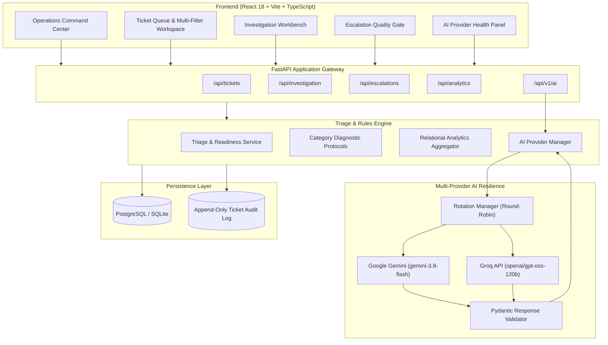

# SupportDesk

> **Investigate Faster. Resolve Smarter. Support Better.**

An intelligent support operations and triage platform designed for **RideOps** to streamline customer issue investigations, eliminate premature engineering escalations, and clear backlogs through data-driven diagnostic workflows.

[](backend/tests/)
[](https://www.python.org/)
[](https://fastapi.tiangolo.com/)
[](https://react.dev/)
[](https://tailwindcss.com/)
[](docker-compose.yml)
[](#-multi-provider-ai-architecture-gemini--groq)

---

## 1. Executive Summary & Business Context

**RideOps** provides corporate employee transportation for ~200 corporate clients, operating shift rosters, live cab GPS tracking, boarding OTPs, and corporate billing.

Between July and September 2026, leadership noted:
> *"Support is drowning. Open tickets are up about 60% since July and our clients are noticing. Bring that number down."*

Stakeholders offered conflicting explanations:
- **Meera (Support Lead):** Believed engineering turnaround was the main bottleneck and demanded more headcount.
- **Sandeep (Engineering Manager):** Believed support escalated tickets without preliminary checks, swamping engineers with basic configuration issues.
- **Ritika (Head of Operations):** Demanded backlog reduction this quarter with **zero budget for new hires**.

---

## 2. Evidence-Based Data Findings (1,444 Ticket Records)

Rather than taking sides, we conducted an empirical analysis across the complete dataset of 1,444 tickets logged between 2 July 2026 and 30 September 2026:

| Operational Metric | Data Finding | Business Impact |
| :--- | :--- | :--- |
| **Ticket Volume Growth** | **+51.79%** (390 in July → 592 in Sept) | Intake spiked without any headcount additions. |
| **Engineering Escalation Rate** | **33.66%** (486 out of 1,444 tickets) | 1 in 3 incoming tickets was escalated to Engineering. |
| **Escalation Bounce Rate** | **35.59%** (173 out of 486 escalations) | **Sandeep was right:** 173 tickets bounced back to L1 (*89 Insufficient Info*, *84 Client Config Errors*). |
| **Avoidable Escalation Rate** | **56.58%** (275 out of 486 escalations) | Non-bug handoffs (*Config*, *Insufficient Info*, *Duplicates*, *How-tos*). |
| **Resolution Time: Direct L1** | **19.96 hours** (median 12.57h) | Normal L1 resolution is prompt and sustainable. |
| **Resolution Time: Escalated** | **99.79 hours** (~4.1 days) | Escalation multiplies resolution time by 5x. |
| **Resolution Time: Bounced** | **141.45 – 142.27 hours** (~5.9 days) | **Meera was right:** Bounced tickets sit in limbo, destroying SLAs. |
| **CSAT Destruction** | Unescalated: **4.01 / 5** → Bounced: **2.43 / 5** | Unresolved client issues destroy customer satisfaction. |
| **Category Concentration** | Top 3 categories = **77.98% of all escalations** | *Roster Sync* (175 esc), *Live GPS* (127 esc), *Report Export* (77 esc). |

### The Root Cause: The Escalation-Rejection Doom Loop
Support had no standardized triage tools or category checklists. When volume surged +51.8%, agents began escalating prematurely. Engineering rejected 35.6% of them, blowing resolution times to ~142 hours, causing repeated client follow-ups, and inflating the open ticket backlog.

---

## 3. Product Architecture

SupportDesk breaks the doom loop by empowering the **L1 Support Agent** with guided diagnostic checklists and an **Escalation Quality Gate** that stops incomplete tickets before they ever reach engineering.



---

## 4. Key Features

### A. Operations Command Center
- Live, backend-calculated KPIs: Active Backlog, Escalation Rate (%), Escalation Bounce Rate (%), Mean Resolution Hours, CSAT.
- Interactive Recharts: Weekly Inflow Trajectory, Top Category Escalations, and Escalation Outcome Breakdown.
- Immediate high-priority (P1/P2) open backlog alerting.

### B. Searchable Ticket Workspace
- Real-time search across Ticket ID, Client Name, and Problem Description.
- Multi-dimensional filters: Category, Priority, Status, Agent, Tier, Escalated Only.
- Server-side pagination and sorting.

### C. Category Investigation Workbench
- **Category Diagnostic Protocols:** Tailored checklists for *Roster Sync*, *Live GPS*, *Report Exports*, *OTP Boarding*, and *Billing*.
- Interactive check status toggling (`Passed`, `Failed`, `Pending`, `N/A`) with real-time diagnostic findings logging.
- **Triage Recommendation Engine:** Alerts agents when findings indicate an L1-resolvable client configuration error instead of an engineering defect.

### D. Escalation Quality Gate
- Computes an objective readiness score (0–100%) and blocks handoffs if mandatory preliminary checks are missing.
- Structured escalation packaging: reproduction steps, expected behavior, actual behavior, and affected fleet impact.
- **Audited Manager Bypass:** Enables emergency escalations for critical outages with mandatory audit justification.

### E. Multi-Provider AI Resilience Engine (Gemini + Groq)
- Dual integration with **Google Gemini** (`gemini-3.8-flash`) and **Groq** (`openai/gpt-oss-120b`).
- Atomic round-robin request rotation across concurrent sessions.
- Automatic 5xx/429 failure detection, temporary cooldown timers, and seamless fallback.
- Auto-generates ticket summaries, highlights missing preliminary details, and drafts escalation briefs.
- **100% Core Independence:** The application functions fully without either API key configured.

---

## 5. Technology Stack

- **Frontend:** React 18, TypeScript, Vite, Tailwind CSS, Lucide Icons, Recharts
- **Backend:** Python 3.11 / 3.13, FastAPI, Pydantic v2, SQLAlchemy 2.0, NumPy, Pandas, HTTPX
- **Database:** PostgreSQL (Production) / SQLite (Zero-dependency Local Development)
- **AI Providers:** Google Gemini Interactions API (`gemini-3.8-flash`), Groq Chat Completions API (`openai/gpt-oss-120b`)
- **DevOps:** Docker, Docker Compose, Nginx, Render

---

## 6. Local Quick-Start Guide

### Prerequisites
- Python 3.11+
- Node.js 18+ and npm
- (Optional) Docker & Docker Compose

### 1. Clone & Set Up Environment
```bash
git clone https://github.com/nitin-code6/SupportDesk.git
cd SupportDesk

# Copy environment template
cp .env.example .env
```

### 2. Backend Setup
```bash
# Navigate to backend
cd backend

# Create virtual environment and install dependencies
python -m venv .venv
source .venv/bin/activate  # On Windows: .venv\Scripts\activate
pip install -r requirements.txt

# Run secure CSV data ingestion (idempotent, 1,444 records)
python scripts/import_tickets.py --file ../reference/rideops_support_tickets.csv

# Run automated test suite
PYTHONPATH=. pytest tests -v

# Start FastAPI backend
uvicorn app.main:app --host 0.0.0.0 --port 8000 --reload
```
The backend API is accessible at `http://localhost:8000` (Swagger docs at `http://localhost:8000/docs`).

### 3. Frontend Setup
```bash
# Navigate to frontend (in a new terminal)
cd frontend

# Install dependencies and build
npm install
npm run build

# Start development server
npm run dev
```
The frontend is accessible at `http://localhost:5173`.

---

## 7. Docker & Docker Compose Setup

Run the entire production stack (PostgreSQL + FastAPI + React/Nginx) with a single command:

```bash
docker-compose up --build
```

- **Frontend:** `http://localhost:3000` or `http://localhost:80`
- **Backend API:** `http://localhost:8000`
- **API Health:** `http://localhost:8000/api/health`

---

## 8. Multi-Provider AI Testing & Telemetry

### Automated Unit & Mock Tests
```bash
PYTHONPATH=backend pytest backend/tests/test_ai_providers.py -v
```

### Live API Smoke Test
To test live rotation, failure detection, and automatic failover between Google Gemini and Groq:
```bash
python backend/scripts/smoke_test_ai.py
```

### AI Observability Endpoint
Inspect live health, active strategy, request counts, and masked error telemetry:
```bash
curl http://localhost:8000/api/v1/ai/health
```

---

## 9. Render Deployment Configuration

SupportDesk is prepared for turnkey deployment on Render via `render.yaml`:
- **Managed Database:** PostgreSQL 16
- **Backend Web Service:** Docker runtime building `backend/Dockerfile` with database connection string injection.
- **Frontend Web Service:** Static site publishing `frontend/dist` with SPA client rewrite rules.

---

## 10. Four-Week Improvement Plan

| Timeline | Milestone | Key Outcomes |
| :--- | :--- | :--- |
| **Week 1** | **L1 Triage Pilot** | Deploy diagnostic checklists for *Roster Sync* and *GPS Tracking* to top-escalating agents. Target: category bounce rate &lt; 20%. |
| **Week 2** | **Quality Gate Hardening** | Enforce quality gate across all 8 agents and 10 categories. Target: eliminate 30% of engineering escalation volume. |
| **Week 3** | **Client Self-Service Interception** | Provide CSV upload validation and live fleet status in client admin portal. Target: reduce ticket intake by 15%. |
| **Week 4** | **SLA Governance** | Weekly cross-functional reviews with Meera, Sandeep, and Ritika. Target: mean resolution &lt; 24h; CSAT &gt; 4.0. |

---

## 11. Security & Data Protection Notice

- **Reference File Safeguards:** All original source materials (`*.pdf`, `*.csv`, `*.zip`) are permanently excluded via `.gitignore` and `.git/info/exclude`. Zero raw customer datasets are stored in Git.
- **Credential Hygiene:** API keys are never hardcoded, never logged, and never returned in error traces or telemetry endpoints.
