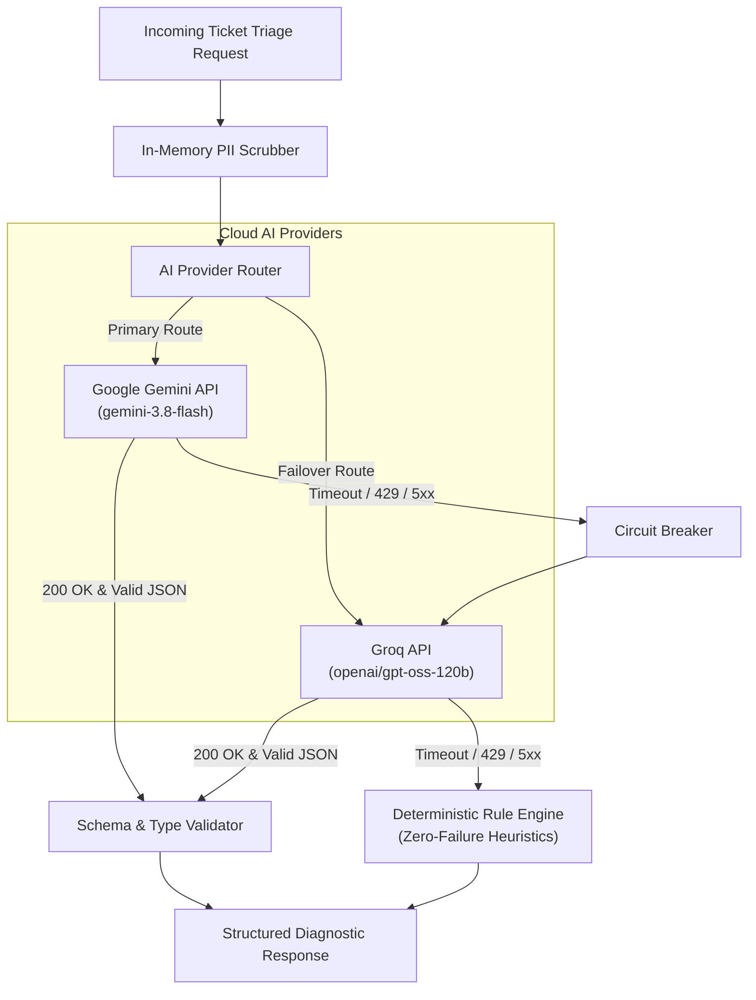

# SupportDesk AI Architecture & Multi-Provider Resilience

SupportDesk features an enterprise-grade AI diagnostic copilot designed to empower Tier 1 support agents during incident triage. The subsystem incorporates multi-model rotation, automated fallback, PII sanitization, and deterministic local heuristics to ensure zero downtime.

---

## 1. Multi-Provider Architecture



### Supported Providers:
1. **Google Gemini (Primary)**:
   - Model: `gemini-3.8-flash`
   - Purpose: High-speed classification, diagnostic reasoning, and draft note generation.
2. **Groq (Fast Fallback)**:
   - Model: `openai/gpt-oss-120b` (or Llama-3-70b-versatile)
   - Purpose: Ultra-low-latency secondary fallback when Google API rate limits or latency thresholds trigger.
3. **Deterministic Local Heuristic Engine (Tertiary)**:
   - Zero-dependency Python rule engine matching keywords, category patterns, and ground-truth protocols. Guarantees 100% uptime even during complete network severance.

---

## 2. In-Memory PII Sanitization

Before sending customer tickets or internal notes to third-party AI APIs, the text passes through `backend/app/services/pii_scrubber.py`.

### Redaction Rules:
- **Email Addresses**: `[a-zA-Z0-9_.+-]+@[a-zA-Z0-9-]+\.[a-zA-Z0-9-.]+` $\rightarrow$ `[REDACTED_EMAIL]`
- **Phone Numbers**: `(\+?\d{1,3}[-.\s]?)?(\(?\d{3}\)?[-.\s]?)?\d{3}[-.\s]?\d{4}` $\rightarrow$ `[REDACTED_PHONE]`
- **IPv4 Addresses**: `\b\d{1,3}\.\d{1,3}\.\d{1,3}\.\d{1,3}\b` $\rightarrow$ `[REDACTED_IP]`
- **Bearer Tokens / API Keys**: `(bearer\s+[a-zA-Z0-9_\-\.]{20,}|sk-[a-zA-Z0-9]{20,})` $\rightarrow$ `[REDACTED_TOKEN]`
- **Credit Card / PAN Numbers**: `\b\d{4}[-\s]?\d{4}[-\s]?\d{4}[-\s]?\d{4}\b` $\rightarrow$ `[REDACTED_CARD]`

*Note: Redaction operates purely in volatile memory. Original ticket descriptions stored in the database remain intact for legal audit purposes.*

---

## 3. Strict JSON Schema Validation

AI providers are instructed to respond exclusively in raw, valid JSON matching the following contract:

```json
{
  "recommended_action": "investigate_locally",
  "suggested_category": "Routing & Geofencing",
  "confidence_score": 0.94,
  "checklist_focus": [
    "Verify Geofence Boundary Polygon",
    "Inspect Dispatch Cache Sync"
  ],
  "draft_investigation_note": "Preliminary analysis suggests boundary coordinates were updated in admin portal but cache was not evicted.",
  "probable_root_cause": "configuration_oversight",
  "reasoning": "Vehicle traversed coordinates outside perimeter immediately following shift update."
}
```

### Safety & Parse Enforcement:
- If an LLM returns markdown fences (e.g. ` ```json ... ``` `), the parser cleanly strips enclosing code blocks.
- If the JSON cannot be parsed or lacks required fields, the circuit breaker triggers fallback to the next provider.

---

## 4. Circuit Breaker & Timeout Configuration

The system uses `httpx.AsyncClient` with strict connection and read timeouts configured via environment variables:

| Variable | Default Value | Purpose |
| :--- | :---: | :--- |
| `AI_REQUEST_TIMEOUT` | `30` | Maximum seconds before an API request is aborted. |
| `AI_ROTATION_STRATEGY` | `round_robin` | Selection strategy: `round_robin`, `primary_fallback`, or `cost_optimized`. |
| `AI_FALLBACK_ENABLED` | `"true"` | When true, failures automatically cascade to backup providers. |
| `GEMINI_MODEL` | `gemini-3.8-flash` | Gemini model endpoint identifier. |
| `GROQ_MODEL` | `openai/gpt-oss-120b` | Groq model endpoint identifier. |

---

## 5. Live Telemetry & Health Monitoring

The `/api/v1/ai/health` endpoint exposes rolling operational metrics:
- Provider availability status (`healthy`, `degraded`, `unavailable`)
- Rolling P95 latency in milliseconds
- Total successful inferences vs failed attempts
- Fallback activation counter
- Current active rotation strategy
