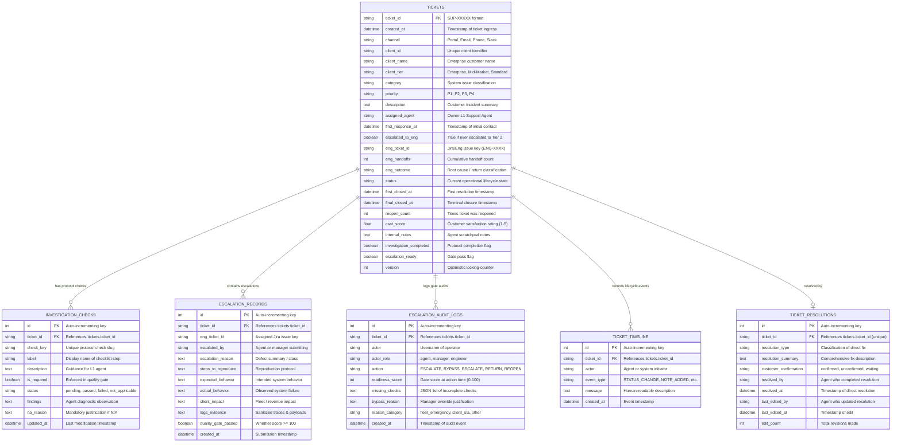

# SupportDesk Database Architecture & Data Dictionary

SupportDesk uses a relational data model designed to support operational triage, structured diagnostic protocols, escalation quality gates, and team analytics for RideOps fleet operations. 

In production on Render, the system runs on **Managed PostgreSQL**; in local development, it can run on **PostgreSQL** or **SQLite** with WAL mode enabled.

---

## 1. Entity-Relationship Diagram (ERD)

---

## 2. Table Specifications & Data Dictionary

### Table: `tickets`
The core table containing all 1,444 historical and active RideOps operational tickets spanning 2 July 2026 to 30 September 2026.

| Column | Type | Nullable | Default | Description & Validation Rules |
| :--- | :--- | :---: | :---: | :--- |
| `ticket_id` | `VARCHAR(32)` | No | — | Primary key. Format `SUP-XXXXX` (e.g. `SUP-10001` to `SUP-11444`). Indexed. |
| `created_at` | `DATETIME` | No | — | Timestamp ticket entered RideOps queue. Indexed for time-series aggregation. |
| `channel` | `VARCHAR(32)` | No | — | Ingress channel: `Portal`, `Email`, `Phone`, `Slack`. |
| `client_id` | `VARCHAR(32)` | No | — | Corporate client ID (e.g. `CL-101`). Indexed. |
| `client_name` | `VARCHAR(128)` | No | — | Enterprise name: `Apex Logistics`, `Metro Transit`, `Orion Fleet`, etc. Indexed. |
| `client_tier` | `VARCHAR(32)` | No | — | Service tier: `Enterprise`, `Mid-Market`, `Standard`. |
| `category` | `VARCHAR(128)` | No | — | Category: `Routing & Geofencing`, `Billing & Invoicing`, `Driver Mobile App`, `API & Webhooks`, etc. |
| `priority` | `VARCHAR(8)` | No | — | Urgency level: `P1` (Critical), `P2` (High), `P3` (Medium), `P4` (Low). Indexed. |
| `description` | `TEXT` | No | — | Detailed customer issue description. Scrubbed of PII in memory during AI queries. |
| `assigned_agent` | `VARCHAR(64)` | No | — | Assigned L1 agent: `Ananya R`, `Vikram S`, `Priya M`, `Karan B`, `Rahul T`. Indexed. |
| `first_response_at`| `DATETIME` | Yes | NULL | Timestamp of initial agent response. |
| `escalated_to_eng`| `BOOLEAN` | No | `FALSE` | Boolean flag indicating whether ticket was escalated to Engineering. Indexed. |
| `eng_ticket_id` | `VARCHAR(32)` | Yes | NULL | Engineering Jira reference key (e.g. `ENG-4021`). Indexed. |
| `eng_handoffs` | `INTEGER` | No | `0` | Number of times ticket transitioned between L1 and Engineering. |
| `eng_outcome` | `VARCHAR(64)` | Yes | NULL | Outcome: `Fixed - Bug`, `Sent back - Configuration`, `Sent back - Missing Info`, `No Defect Found`, `Workaround Provided`. |
| `status` | `VARCHAR(32)` | No | — | Operational state: `Closed`, `Open - with L1`, `Open - with Engineering`, `Ready to Escalate`, `Reopened`. Indexed. |
| `first_closed_at` | `DATETIME` | Yes | NULL | Timestamp of initial closure. |
| `final_closed_at` | `DATETIME` | Yes | NULL | Timestamp of definitive terminal closure. Used for turnaround duration. |
| `reopen_count` | `INTEGER` | No | `0` | Number of times customer or system reopened the incident. |
| `csat_score` | `FLOAT` | Yes | NULL | Customer satisfaction rating on a 1.0 to 5.0 scale. |
| `internal_notes` | `TEXT` | Yes | NULL | Operator notes and diagnostic observations. |
| `investigation_completed` | `BOOLEAN` | No | `FALSE` | Set to true when all required checklist items are answered. |
| `escalation_ready`| `BOOLEAN` | No | `FALSE` | Set to true when Quality Gate readiness score reaches 100%. |
| `version` | `INTEGER` | No | `1` | Optimistic locking counter incremented on every state transition. |

#### Composite Indexes:
- `ix_tickets_cat_status`: (`category`, `status`) — accelerates category-level queue filtering.
- `ix_tickets_agent_status`: (`assigned_agent`, `status`) — optimizes agent workload and team insights.
- `ix_tickets_esc_outcome`: (`escalated_to_eng`, `eng_outcome`) — speeds up escalation bounce analysis.

---

### Table: `investigation_checks`
Tracks structured diagnostic checklists dynamically instantiated per category (e.g. Geofence Boundary check, Cache verification, Roster sync check).

| Column | Type | Nullable | Default | Description |
| :--- | :--- | :---: | :---: | :--- |
| `id` | `INTEGER` | No | Auto | Primary key. |
| `ticket_id` | `VARCHAR(32)` | No | — | Foreign key referencing `tickets.ticket_id` (Cascading delete). Indexed. |
| `check_key` | `VARCHAR(64)` | No | — | Unique checklist identifier (e.g. `verify_roster_sync`, `test_payload`). |
| `label` | `VARCHAR(255)` | No | — | Human-readable instruction title. |
| `description` | `TEXT` | Yes | NULL | Detailed step-by-step diagnostic procedure. |
| `is_required` | `BOOLEAN` | No | `TRUE` | Whether this step is mandatory for Quality Gate clearance. |
| `status` | `VARCHAR(32)` | No | `'pending'` | Current status: `pending`, `passed`, `failed`, `not_applicable`. |
| `findings` | `TEXT` | Yes | NULL | Operator's documented observations and findings. |
| `na_reason` | `TEXT` | Yes | NULL | Required explanation when marked `not_applicable`. |
| `updated_at` | `DATETIME` | No | UTC Now | Timestamp of last status change. |

#### Constraints:
- `uq_ticket_check_key`: Unique constraint across (`ticket_id`, `check_key`). Prevents duplicate checks for the same ticket.

---

### Table: `escalation_records`
Stores the structured handoff package created when a ticket passes the Quality Gate or is overridden by a support manager.

| Column | Type | Nullable | Default | Description |
| :--- | :--- | :---: | :---: | :--- |
| `id` | `INTEGER` | No | Auto | Primary key. |
| `ticket_id` | `VARCHAR(32)` | No | — | Foreign key referencing `tickets.ticket_id`. Indexed. |
| `eng_ticket_id` | `VARCHAR(32)` | No | — | Assigned Engineering tracking ID (`ENG-XXXX`). |
| `escalated_by` | `VARCHAR(64)` | No | — | Agent or manager username submitting the escalation. |
| `escalation_reason` | `TEXT` | No | — | Technical defect classification and escalation justification. |
| `steps_to_reproduce` | `TEXT` | No | — | Clear, numbered reproduction protocol. |
| `expected_behavior` | `TEXT` | No | — | Intended functional behavior. |
| `actual_behavior` | `TEXT` | No | — | Observed defect or anomalous behavior. |
| `client_impact` | `TEXT` | Yes | NULL | Impact on client SLA, fleet operations, or revenue. |
| `logs_evidence` | `TEXT` | Yes | NULL | Sanitized log snippets, payload traces, or screenshot URLs. |
| `quality_gate_passed` | `BOOLEAN`| No | `FALSE` | Flag indicating whether standard gate verification passed (score = 100). |
| `created_at` | `DATETIME` | No | UTC Now | Timestamp of escalation creation. |

---

### Table: `escalation_audit_logs`
Immutable compliance and governance log recording every escalation, manager bypass, and ticket return.

| Column | Type | Nullable | Default | Description |
| :--- | :--- | :---: | :---: | :--- |
| `id` | `INTEGER` | No | Auto | Primary key. |
| `ticket_id` | `VARCHAR(32)` | No | — | Foreign key referencing `tickets.ticket_id`. Indexed. |
| `actor` | `VARCHAR(64)` | No | — | Full name or handle of the user initiating the action. |
| `actor_role` | `VARCHAR(32)` | No | — | Role: `agent`, `manager`, `engineer`. |
| `action` | `VARCHAR(32)` | No | — | Action: `ESCALATE`, `BYPASS_ESCALATE`, `RETURN`, `REOPEN`. |
| `readiness_score`| `INTEGER` | No | — | Quality Gate readiness score at time of action (0 to 100). |
| `missing_checks` | `TEXT` | Yes | NULL | JSON string listing checklist keys that were incomplete or failed. |
| `bypass_reason` | `TEXT` | Yes | NULL | Mandatory managerial justification if `BYPASS_ESCALATE`. |
| `reason_category`| `VARCHAR(64)`| Yes | NULL | Override classification: `fleet_emergency`, `client_sla`, `other`. |
| `created_at` | `DATETIME` | No | UTC Now | Audit record creation timestamp. |

---

### Table: `ticket_timeline`
Chronological activity ledger providing full traceability of every event in a ticket's lifecycle.

| Column | Type | Nullable | Default | Description |
| :--- | :--- | :---: | :---: | :--- |
| `id` | `INTEGER` | No | Auto | Primary key. |
| `ticket_id` | `VARCHAR(32)` | No | — | Foreign key referencing `tickets.ticket_id`. Indexed. |
| `actor` | `VARCHAR(64)` | No | — | System or user identity performing the action. |
| `event_type` | `VARCHAR(64)` | No | — | Event type: `STATUS_CHANGE`, `NOTE_ADDED`, `CHECK_PASSED`, `ESCALATED`, `RETURNED`, `RESOLVED`. |
| `message` | `TEXT` | No | — | Human-readable event description. |
| `created_at` | `DATETIME` | No | UTC Now | Event timestamp. |

---

### Table: `ticket_resolutions`
Records structured resolutions when an L1 agent resolves a ticket directly without escalating to Engineering.

| Column | Type | Nullable | Default | Description |
| :--- | :--- | :---: | :---: | :--- |
| `id` | `INTEGER` | No | Auto | Primary key. |
| `ticket_id` | `VARCHAR(32)` | No | — | Unique foreign key referencing `tickets.ticket_id`. Indexed. |
| `resolution_type`| `VARCHAR(64)`| No | — | Root cause category: `configuration_corrected`, `customer_guidance_provided`, `access_fixed`, `engineering_verified`, `other`. |
| `resolution_summary`| `TEXT` | No | — | Comprehensive explanation of corrective steps and verification. |
| `customer_confirmation`| `VARCHAR(32)`| No | — | Client status: `confirmed`, `unconfirmed`, `waiting`. |
| `resolved_by` | `VARCHAR(64)` | No | — | Agent username who performed the resolution. |
| `resolved_at` | `DATETIME` | No | UTC Now | Timestamp when ticket was marked resolved. |
| `last_edited_by` | `VARCHAR(64)` | Yes | NULL | Agent username who last edited the resolution details. |
| `last_edited_at` | `DATETIME` | Yes | NULL | Timestamp of latest modification. |
| `edit_count` | `INTEGER` | No | `0` | Number of times the resolution was revised. |

---

## 3. Ground-Truth Data Ingestion & Seeding

The database is initialized using `backend/seed.py`, which parses `dataset.csv`:

1. **Dataset Integrity**: Exactly 1,444 tickets are verified and loaded.
2. **Snapshot Realities (As of 30 Sept 2026)**:
   - 1,396 Closed tickets.
   - 29 Open tickets with L1 Support.
   - 19 Open tickets with Engineering (Tier 2).
   - Total active backlog: 48 tickets.
3. **Automated Protocol Check Generation**:
   - For all active tickets, `backend/app/routers/investigation.py` automatically populates the category-specific diagnostic checklist on first access if not previously saved.
4. **Resilience & Safe Idempotency**:
   - Seeding checks if records already exist (`Ticket.query.count() == 1444`). If populated, it skips re-inserting to prevent duplicate key violations and preserve operator state across restarts.
