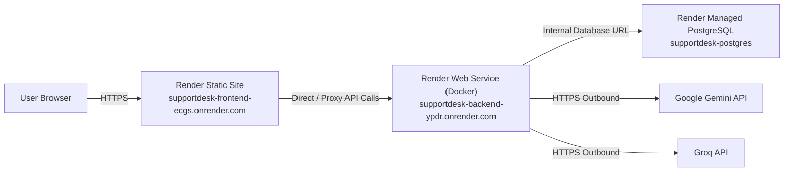

# SupportDesk Deployment & Operations Manual

This guide documents the production deployment architecture on **Render**, containerization with **Docker**, environment variable configurations, and local development setup.

---

## 1. Production Architecture on Render

SupportDesk is deployed on Render using a declarative Infrastructure-as-Code Blueprint (`render.yaml`):



### Production Service Inventory:
| Service Name | Type | Runtime | Plan | Live URL |
| :--- | :---: | :---: | :---: | :--- |
| `supportdesk-frontend-ecgs` | Static Site | Node.js (Vite Build) | Free | [supportdesk-frontend-ecgs.onrender.com](https://supportdesk-frontend-ecgs.onrender.com/) |
| `supportdesk-backend-ypdr` | Web Service | Docker (Python 3.11) | Free | [supportdesk-backend-ypdr.onrender.com](https://supportdesk-backend-ypdr.onrender.com/) |
| `supportdesk-postgres` | Database | PostgreSQL 16 | Free | Managed Internal Connection |

---

## 2. Infrastructure as Code (`render.yaml`)

```yaml
services:
  # Backend Web Service
  - type: web
    name: supportdesk-backend
    runtime: docker
    dockerContext: ./backend
    dockerfilePath: ./backend/Dockerfile
    plan: free
    region: oregon
    envVars:
      - key: DATABASE_URL
        fromDatabase:
          name: supportdesk-postgres
          property: connectionString
      - key: ENVIRONMENT
        value: production
      - key: GEMINI_API_KEY
        sync: false
      - key: GEMINI_MODEL
        value: gemini-3.8-flash
      - key: GEMINI_API_URL
        value: https://generativelanguage.googleapis.com/v1beta/interactions
      - key: GROQ_API_KEY
        sync: false
      - key: GROQ_MODEL
        value: openai/gpt-oss-120b
      - key: GROQ_API_URL
        value: https://api.groq.com/openai/v1/chat/completions
      - key: AI_ROTATION_STRATEGY
        value: round_robin
      - key: AI_FALLBACK_ENABLED
        value: "true"
      - key: AI_REQUEST_TIMEOUT
        value: "30"
    healthCheckPath: /api/health

  # Frontend Static Site
  - type: web
    name: supportdesk-frontend
    runtime: static
    buildCommand: cd frontend && npm install && npm run build
    staticPublishPath: ./frontend/dist
    envVars:
      - key: VITE_API_URL
        fromService:
          type: web
          name: supportdesk-backend
          property: host
    routes:
      - type: rewrite
        source: /api/*
        destination: https://supportdesk-backend-ypdr.onrender.com/api/*
      - type: rewrite
        source: /*
        destination: /index.html

databases:
  # Managed PostgreSQL
  - name: supportdesk-postgres
    databaseName: supportdesk
    user: supportdesk_user
    region: oregon
    plan: free
```

---

## 3. Production Environment Variables Reference

| Key | Required | Default / Format | Description |
| :--- | :---: | :--- | :--- |
| `DATABASE_URL` | Yes | `postgresql://...` | Connection string for Managed PostgreSQL. Automatically adapted to `postgresql+psycopg2://` in code. |
| `ENVIRONMENT` | Yes | `production` | Set to `production` or `development`. |
| `GEMINI_API_KEY` | Optional | `AIzaSy...` | Google Cloud API key for Gemini 3.8 Flash inference. |
| `GEMINI_MODEL` | Optional | `gemini-3.8-flash` | Gemini model identifier. |
| `GROQ_API_KEY` | Optional | `gsk_...` | Groq API key for low-latency Llama fallback inference. |
| `GROQ_MODEL` | Optional | `openai/gpt-oss-120b` | Groq model identifier. |
| `AI_ROTATION_STRATEGY`| Optional | `round_robin` | Selection strategy: `round_robin`, `primary_fallback`, `cost_optimized`. |
| `AI_FALLBACK_ENABLED` | Optional | `"true"` | Enables automatic cascade to secondary providers on errors. |
| `AI_REQUEST_TIMEOUT` | Optional | `"30"` | Timeout in seconds before aborting slow upstream AI calls. |
| `VITE_API_URL` | Optional | `https://supportdesk-backend-ypdr.onrender.com` | Base URL used by the frontend to dispatch API requests. |

---

## 4. Local Development Setup

To run SupportDesk locally on Windows, macOS, or Linux:

### Step 1: Clone the Repository
```bash
git clone https://github.com/nitin-code6/SupportDesk.git
cd SupportDesk
```

### Step 2: Configure and Start the Backend
```bash
cd backend
python -m venv venv

# Windows:
.\venv\Scripts\Activate.ps1
# Linux/macOS:
source venv/bin/activate

pip install -r requirements.txt

# Run initial database seeding (loads 1,444 ground-truth tickets)
python seed.py

# Launch FastAPI development server
uvicorn app.main:app --host 127.0.0.1 --port 8000 --reload
```
*Backend runs on `http://127.0.0.1:8000` with Swagger UI at `http://127.0.0.1:8000/docs`.*

### Step 3: Configure and Start the Frontend
```bash
cd ../frontend
npm install
npm run dev
```
*Frontend runs on `http://127.0.0.1:5173`.*

---

## 5. Docker Deployment

To build and run the backend locally in a container matching the Render environment:

```bash
docker build -t supportdesk-backend ./backend
docker run -p 8000:8000 -e ENVIRONMENT=production supportdesk-backend
```
