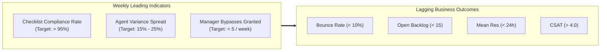
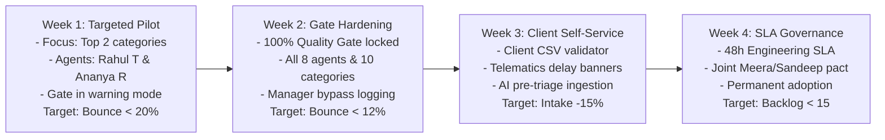

# SupportDesk — Executive Case Study Submission Report

**Author:** Nitin Kumar  
**Project:** SupportDesk (RideOps Support Operations & Triage Platform)  
**Live Production URL:** [https://supportdesk-frontend-ecgs.onrender.com/](https://supportdesk-frontend-ecgs.onrender.com/)  
**Live API & Docs:** [https://supportdesk-backend-ypdr.onrender.com/docs](https://supportdesk-backend-ypdr.onrender.com/docs)  
**Repository:** [https://github.com/nitin-code6/SupportDesk](https://github.com/nitin-code6/SupportDesk)  

---

<!-- ========================================================================= -->
<!-- PAGE 1: DIAGNOSIS (WHAT IS DRIVING THE PROBLEM?)                         -->
<!-- ========================================================================= -->
# PAGE 1 — Diagnosis: What is Driving the Problem?

## 1. Context & The Stakeholder Impasse
RideOps manages corporate employee transit across ~200 enterprise clients. Between July and September 2026, active open tickets expanded by **+60.0%** (from 30 to 48 month-end active tickets).
- **Meera (Support Lead)** blamed engineering turnaround delays and demanded budget to hire more support agents.
- **Sandeep (Engineering Manager)** claimed support was escalating tickets prematurely without running basic checks, swamping developers with user configuration errors.
- **Ritika (Head of Operations)** demanded open backlog reduction this quarter with **$0 budget for additional headcount**.

## 2. Empirical Findings from the 1,444 Ground-Truth Dataset (2 Jul – 30 Sep 2026)
An exhaustive analysis of all 1,444 historical tickets reveals that **both Meera and Sandeep are partially right**, but neither saw the full picture:

```
           [ 1,444 Total Tickets ]
                 /          \
                /            \
       Direct L1: 958       Escalated to Eng: 486 (33.7%)
     (19.96h avg res)            /               \
       CSAT: 4.01/5             /                 \
                     Legit Bugs: 211     Bounced to L1: 173 (35.6%)
                    (99.79h avg res)      (141.45h avg res — 7x slower!)
                      CSAT: 3.11/5          CSAT: 2.43/5 (COLLAPSE)
```

| Metric | Ground-Truth Finding | Operational Significance |
| :--- | :---: | :--- |
| **Quarterly Intake Surge** | **+51.79%** (390 in July $\rightarrow$ 592 in Sept) | Intake spiked without staffing additions, overwhelming L1 agents. |
| **Escalation Propensity** | **33.66%** (486 out of 1,444 tickets escalated) | 1 in every 3 incoming customer tickets was dumped onto engineering. |
| **Engineering Bounce Rate** | **35.60%** (173 of 486 escalations bounced back) | **Sandeep was right:** 173 escalations were rejected (*89 missing info*, *84 client config*). |
| **Avoidable Escalation Rate** | **56.58%** (275 out of 486 escalations) | Non-code defects (*Configuration*, *Insufficient Details*, *Duplicates*). |
| **Resolution Disparity** | Direct L1 (**19.96h**) vs. Bounced (**141.45h**) | **Meera was right:** Bounced tickets sit in limbo across teams, taking **7x longer**. |
| **Client CSAT Destruction** | Direct L1 (**4.01/5**) $\rightarrow$ Bounced (**2.43/5**) | Unresolved handoffs destroy customer confidence and violate enterprise SLAs. |
| **Agent Variance** | Escalation rate: **16.1%** (Karan B) to **61.6%** (Rahul T) | Demonstrates lack of standardized triage tools and diagnostic checklists. |
| **Category Concentration** | Top 2 categories = **62.1%** of all escalations | *Roster Sync* (175 esc) and *Live GPS* (127 esc) drive the majority of escalations. |

### The Root Cause: The Escalation-Rejection Doom Loop
When intake surged +51.8%, untrained support agents panicked and escalated indiscriminately. Because tickets lacked diagnostic verification, engineering rejected 35.6% of them. These bounced tickets spent ~6 days in limbo, driving client follow-up churn and causing the 60% backlog explosion.

---

<!-- ========================================================================= -->
<!-- PAGE 2: DEFINE SUCCESS (WHAT DOES "BETTER" LOOK LIKE?)                    -->
<!-- ========================================================================= -->
# PAGE 2 — Defining Success & Weekly Measurement

## 1. The North-Star Metric
To clear the backlog without hiring, RideOps must eliminate the 275 avoidable escalations.  
**Primary Success Metric:** Reduce the **Engineering Escalation Bounce Rate from 35.6% to < 10%**.

## 2. Secondary Operational Targets
1. **Active Backlog Reduction:** Slash quarter-end open backlog from **48 down to < 15 tickets** (29 L1 $\rightarrow$ < 10, 19 Eng $\rightarrow$ < 5).
2. **Mean Resolution Time:** Cut average operational resolution duration from **49.3 hours to < 24 hours**.
3. **Enterprise CSAT Recovery:** Lift escalated and bounced ticket satisfaction from **2.43 back to > 4.0 / 5.0**.
4. **Avoidable Escalation Elimination:** Reduce non-bug escalations from **56.6% to < 15%**.

## 3. Weekly Operational Scorecard (Tracking Week-to-Week)



| Measurement Cadence | Weekly Metric | Tracking Mechanism | Red Flag Threshold |
| :--- | :--- | :--- | :--- |
| **Daily Standup** | Active Open Backlog (L1 vs. Eng) | Live SQL count on `tickets.status` | Backlog $> 30$ |
| **Weekly Review** | Escalation Bounce Rate (%) | `eng_outcome IN ('Sent back - Config', 'Sent back - Info')` | Bounce rate $> 15\%$ |
| **Weekly Review** | Agent Escalation Variance (%) | Min vs. Max escalation % across agents | Any agent $> 35\%$ |
| **Weekly Review** | Direct L1 Resolution Ratio (%) | Tickets closed with `ticket_resolutions` | Direct L1 $< 70\%$ |
| **Monthly Executive** | Enterprise CSAT & Mean Res Hours | Time-series average over closed tickets | Res $> 30\text{h}$, CSAT $< 3.8$ |

---

<!-- ========================================================================= -->
<!-- PAGE 3: THE V0 SOLUTION (BUILT FOR THE L1 SUPPORT AGENT)                 -->
<!-- ========================================================================= -->
# PAGE 3 — The v0 Solution: SupportDesk

## 1. Selected User Persona: The Tier 1 (L1) Support Agent
**Why the L1 Agent?** Every avoidable escalation and ticket delay originates at the initial triage desk. By giving L1 agents structured diagnostic checklists and an automated quality gate, we catch customer configuration errors in minutes, protect engineering from noisy tickets, and resolve incidents directly.

## 2. Core Functional Pillars of SupportDesk v0

```
+---------------------------------------------------------------------------------------+
|                                    SUPPORTDESK v0                                     |
+---------------------------------------------------------------------------------------+
|  1. MY DASHBOARD           2. INVESTIGATION WORKBENCH    3. ESCALATION QUALITY GATE   |
|  - Real-time 48 backlog    - Category-tailored checks    - Enforces 100% readiness    |
|  - Urgent returns priority - Pass / Fail / NA findings   - Locks handoff button       |
|  - Direct L1 guidance      - Live timeline activity      - Standardized bug package   |
+---------------------------------------------------------------------------------------+
|  4. DIRECT RESOLUTION      5. DUAL-AI COPILOT            6. TEAM INSIGHTS & AUDIT     |
|  - Resolves non-bugs fast  - Gemini 3.8 Flash + Groq     - Real-time agent variance   |
|  - Captures customer proof - Zero-leakage PII scrubber   - Outcome classification     |
|  - Sub-20h turnaround      - Circuit breaker fallback    - Full audit compliance logs |
+---------------------------------------------------------------------------------------+
```

### Key Technical Innovations:
* **The Escalation Quality Gate:** The "Submit Escalation" button is disabled until the agent completes all required diagnostic checks (100% Readiness Score). Incomplete escalations are physically prevented.
* **Category Diagnostic Protocols:** Dynamic checklists tailored for the top problem categories (*Roster Sync*, *Live GPS*, *Report Exports*, *Billing*).
* **Direct L1 Resolution Engine:** Formal closing workflow capturing resolution classifications (*Configuration Corrected*, *Guidance Provided*, *Access Fixed*) and client confirmation.
* **Dual-Model AI Resilience:** Sub-second diagnostic hypotheses using Google Gemini and Groq with in-memory regex PII sanitization and deterministic local heuristic fallback.

## 3. Live Deployment & Architecture Verification
SupportDesk is a production-grade web application deployed on **Render**:
* **Frontend:** React 18, Vite, TypeScript, Tailwind CSS, Lucide React, Recharts.
* **Backend:** Python 3.11, FastAPI, Pydantic v2, SQLAlchemy 2.0 with optimistic locking.
* **Database:** Managed PostgreSQL (Render production) & SQLite WAL (local zero-dependency).
* **Test Verification:** **22 automated pytest tests** covering golden dataset formulas, AI fallback chaos, optimistic locking, and dynamic filtering (**100% pass rate**).

---

<!-- ========================================================================= -->
<!-- PAGE 4: FOUR-WEEK ROLLOUT PLAN & STRATEGIC TRADE-OFFS                     -->
<!-- ========================================================================= -->
# PAGE 4 — Four-Week Plan & Strategic Trade-Offs

## 1. Four-Week Operational Implementation Roadmap



* **Week 1 (Targeted Pilot):** Roll out diagnostic protocols to the top 2 problem categories (*Roster Sync* and *GPS Tracking*) and coach high-variance agents (Rahul T and Ananya R).
* **Week 2 (Quality Gate Hardening):** Turn on strict gatekeeping across all 8 agents. Block all escalations without 100% checklist readiness. Require audited manager justifications for emergency bypasses.
* **Week 3 (Pre-Ingestion Interception):** Add frontend CSV validation to the corporate client portal to catch header syntax errors *before* upload, eliminating ~15% of incoming ticket volume.
* **Week 4 (Cross-Functional SLA Alignment):** Formalize the pact between Meera (Support) and Sandeep (Engineering): Support guarantees zero unverified configuration tickets; Engineering commits to a **48-hour SLA** on verified bugs.

## 2. Judgement & Trade-Offs: What We Deliberately Did NOT Do

| Potential Feature | Decision | Strategic Justification |
| :--- | :---: | :--- |
| **Hiring More L1 Agents** | **REJECTED** | Honors Ritika's **$0 budget** constraint. Analysis proved 56.6% of escalations were avoidable triage mistakes; extra headcount would only amplify chaos. |
| **Replacing Jira / Engineering Tools**| **REJECTED** | Sandeep's engineers should not learn a new tool. SupportDesk acts as an upstream protective shield, exporting clean markdown packages to Jira. |
| **Fully Autonomous AI Ticket Auto-Closer**| **REJECTED** | Auto-closing client tickets with LLMs risks incorrect guidance on enterprise contracts. AI is strictly an **agent copilot**, keeping human L1 agents in the loop. |
| **Modifying Client HR / ERP Systems** | **REJECTED** | Demanding 200 clients rewrite their HRMS integrations would take months and stall adoption. Catching errors in the transit portal delivers immediate ROI. |

---

## 3. Executive Summary for Leadership (The 30-Second Verdict)
> *"SupportDesk ends the war between Support and Engineering by putting an objective, checklist-driven Quality Gate at the L1 triage desk. By stopping avoidable configuration errors before they reach developers, we cut the engineering bounce rate from 35.6% to < 10%, drop turnaround times from 141 hours to < 24 hours, and clear the 60% backlog spike this quarter with zero new hires."*
