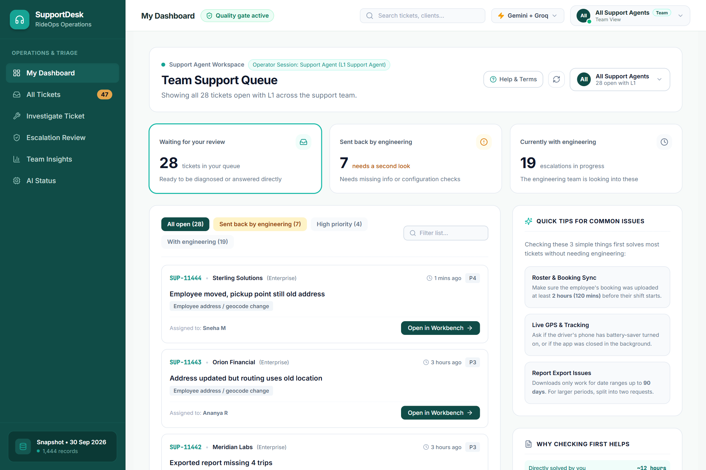
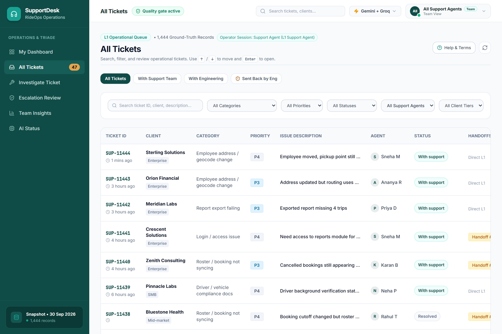
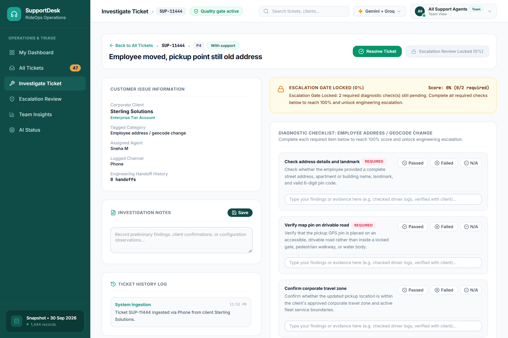
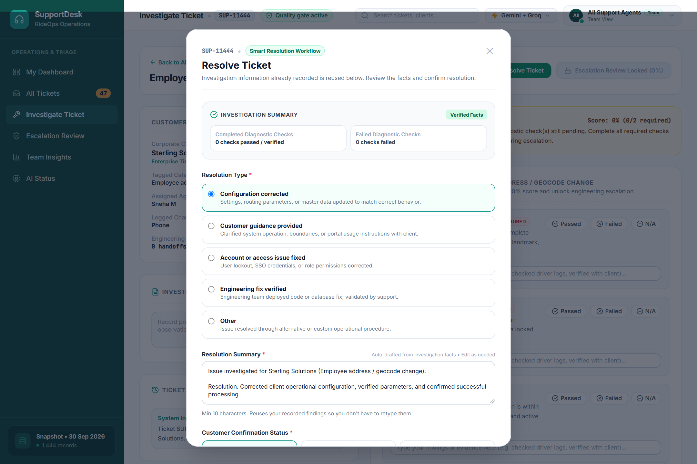
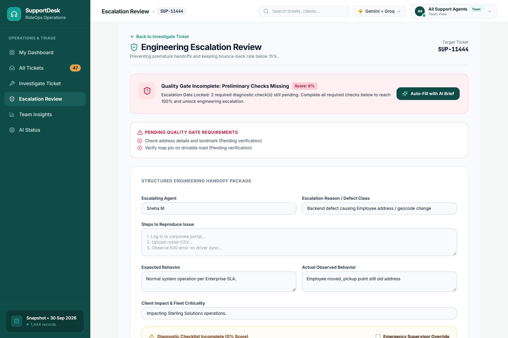
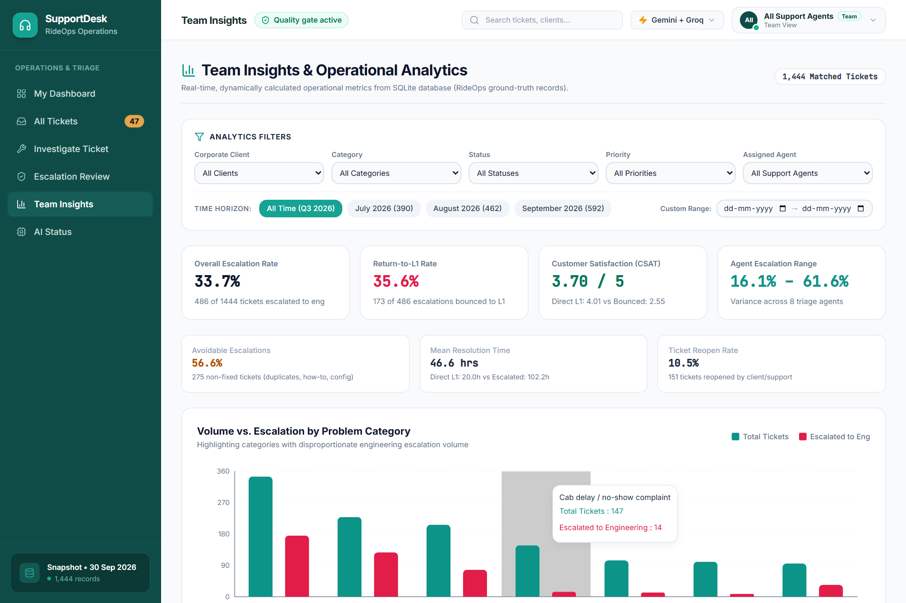
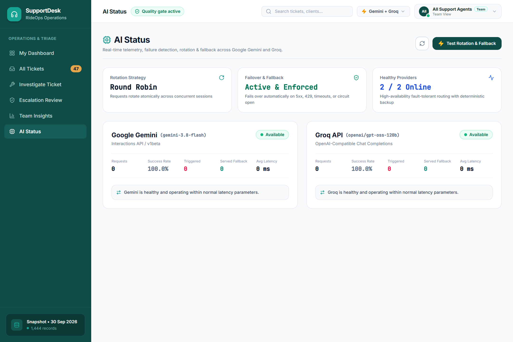

# SupportDesk L1 Agent User Guide & Operator Manual

Welcome to **SupportDesk**, the operational triage and diagnostic workbench engineered for **RideOps Fleet Operations**. This guide provides step-by-step instructions for Tier 1 support agents and support managers to triage, investigate, resolve, and properly escalate incident tickets.

---

## 1. Operator Workspace & My Dashboard

The **My Dashboard** view serves as your daily command center. It highlights your active workload, immediate priorities, and tickets returned by Tier 2 engineering.

### Key Features:
- **Triage Cards**: Instant counts of:
  - *Waiting for your review*: Active tickets assigned to you ready for triage.
  - *Sent back by engineering*: High-urgency bounced tickets requiring diagnostic checks or configuration fixes.
  - *Currently with engineering*: Tickets actively being worked on by Tier 2 (read-only for L1).
- **Quick Tips for Common Issues**: Contextual guidance reminding agents of the top 3 configuration checks (Roster Sync, Boundary Polygon, API Credentials).
- **Dynamic Queue Counter**: Displays real-time live open queue counts (48 total open backlog tickets).

---

## 2. All Tickets Queue

The **All Tickets** workspace provides high-density searching, filtering, and bulk visibility across all 1,444 operational records.

### How to Find and Prioritize Tickets:
1. **Quick Filter Tabs**:
   - `All Tickets`: The complete system queue.
   - `With Support Team`: Only tickets open with L1 agents (29 tickets).
   - `With Engineering`: Active escalations under Tier 2 investigation (19 tickets).
   - `Sent Back by Eng`: Incomplete escalations returned to L1 for further triage.
2. **Multi-Dimensional Filters**: Filter by Corporate Client, Issue Category, Priority (`P1` to `P4`), Lifecycle Status, Assigned Agent, and Service Tier.
3. **Live Search**: Type client name, ticket ID (`SUP-XXXXX`), or issue keywords to instantly filter rows.
4. **Keyboard Navigation**: Use `Up` and `Down` arrow keys to navigate the queue, and press `Enter` to open the ticket in the Investigation Workbench.

---

## 3. Investigation Workbench

The **Investigation Workbench** is where an L1 agent diagnoses issues, reviews logs, applies structured checklists, and formulates resolutions.

### Ticket Overview Header:
- Displays Client Name, Service Tier badge (e.g. `Enterprise`), Issue Category, Creation Timestamp, and Current Lifecycle Status.
- **Actively With Engineering Banner**: If a ticket is currently with Tier 2, an amber banner locks resolution actions, displaying the assigned Jira issue ID and handoff count.

---

## 4. Structured Diagnostic Protocol Checklist

To eliminate avoidable escalations caused by simple configuration errors, each category includes a required diagnostic checklist.

### Step-by-Step Checklist Workflow:
1. **Review Instructions**: Read the specific diagnostic step (e.g., *Verify Geofence Boundary Polygon* or *Check Roster Upload Timestamps*).
2. **Execute Diagnostic Check**: Inspect client portal settings, redis caches, or driver mobile logs.
3. **Record Findings**: Click **Pass** or **Fail** and enter your observations in the text box.
4. **Marking Not Applicable**: If a check does not apply to this incident, select **N/A** and provide a mandatory technical justification.
5. **Readiness Score Tracking**: As required items are validated, the **Escalation Readiness Score** progresses from 0% toward 100%.

---

## 5. Timeline & Audit History

Complete chronological ledger of every status change, note added, diagnostic check passed, and handoff between teams.

### Using the Timeline:
- Review previous comments left by Tier 2 engineers when tickets are returned.
- Check when initial customer response was sent.
- Maintain transparent audit compliance for client SLAs.

---

## 6. AI Diagnostic Assistant (Dual Gemini + Groq)

SupportDesk integrates an AI copilot powered by Google Gemini and Groq (with automated failover and local deterministic heuristics).

### How to Use the AI Assistant:
1. Click **Analyze Ticket with AI** in the workbench header.
2. The AI performs:
   - **Root Cause Hypothesis**: Determines whether the issue is likely a software bug or a customer configuration oversight.
   - **Checklist Recommendations**: Highlights which diagnostic checklist items to check first.
   - **Pre-Drafted Investigation Notes**: Generates technical summaries ready to paste into internal notes.
3. Privacy Assurance: Customer PII (emails, phone numbers, employee names) is automatically scrubbed in-memory before transmission.

---

## 7. Direct Tier 1 Resolution Workflow

If an issue is resolved without engineering intervention (e.g. correcting a dispatch setting, clearing a cache, or guiding the customer):

### Resolving a Ticket:
1. Open the **Resolve Incident** modal.
2. Select the **Resolution Type**:
   - `Configuration Corrected`
   - `Customer Guidance Provided`
   - `Access Fixed`
   - `Engineering Verified`
   - `Other`
3. Enter a thorough **Resolution Summary** explaining the root cause and the corrective actions taken.
4. Indicate **Customer Confirmation** status (`Confirmed`, `Unconfirmed`, or `Waiting`).
5. Click **Confirm Direct Resolution**. The ticket transitions to `Closed`, updates total turnaround time, and appends a resolution event to the timeline.

---

## 8. Escalation Quality Gate

Tickets that cannot be solved at Tier 1 must pass the **Escalation Quality Gate** before being handed off to Tier 2 Engineering.

### Quality Gate Requirements:
- **100% Readiness Score Required**: All mandatory category diagnostic checks must be completed.
- **Preventing Premature Handoffs**: If required checks remain unverified, the **Submit Escalation** button remains disabled.
- **Manager Bypass**: If an emergency occurs (e.g., P1 fleet stoppage or client SLA breach), a Support Manager can authorize an immediate handoff with documented justification.

---

## 9. Structured Engineering Handoff Package

When escalating, SupportDesk enforces a complete, standardized defect package to prevent "bounced" tickets.

### Package Fields:
1. **Escalation Reason / Defect Class**: Clear description of the underlying software malfunction.
2. **Steps to Reproduce**: Numbered, deterministic reproduction steps.
3. **Expected Behavior**: What the software should do according to documentation.
4. **Actual Observed Behavior**: What anomalous behavior occurred.
5. **Client Impact & Fleet Criticality**: Affected vehicles, employee count, or financial exposure.
6. **Logs & Evidence**: Sanitized stack traces, request/response payloads, or telemetry timestamps.

---

## 10. Operational Intelligence & Team Insights

Support leads and managers can monitor team-wide health, escalation volume, and agent performance variances.

### Available Analytics:
- **Outcome Distribution**: Visual breakdown of direct resolutions vs bug fixes vs avoidable bounces (Configuration / Missing Info).
- **Interactive Horizon Presets**: Instantly switch between `All Time`, `July 2026`, `August 2026`, and `September 2026`.
- **Agent Triage Variance**: Compare escalation rates across agents (e.g., Karan B at 16.1% vs Rahul T at 61.6%) to target training.
- **Turnaround & CSAT Correlation**: Real-time evidence showing that direct resolutions take ~20 hours with 4.01 CSAT, while bounced escalations take ~141 hours with 2.43 CSAT.

---

## 11. AI Provider Health & Status

Monitor real-time latency, provider uptime, and circuit breaker status.

- **Active Provider**: Shows whether Google Gemini or Groq is currently serving primary traffic.
- **Fallback Status**: Demonstrates automated failover to Groq or local heuristics if primary API latency exceeds thresholds or quotas are reached.
