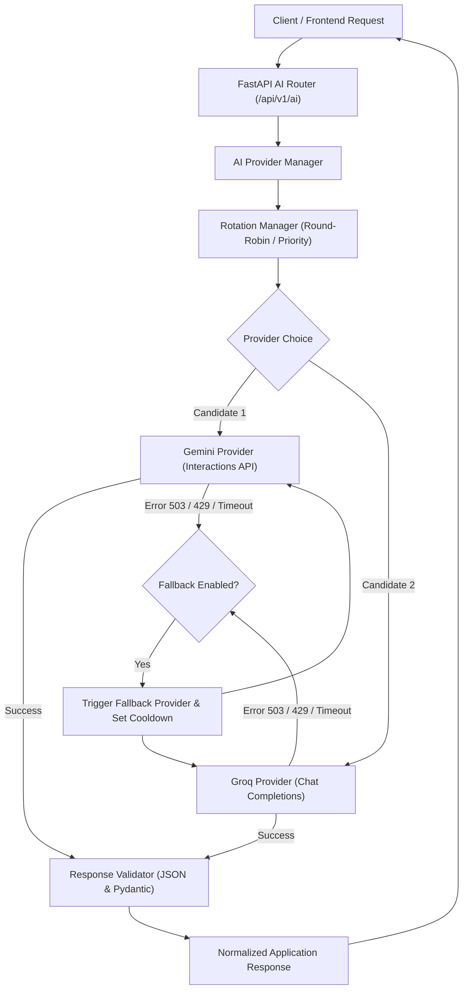

# SupportDesk Multi-Provider AI Architecture (Gemini + Groq)

## 1. Architectural Overview

SupportDesk features an enterprise-grade, resilient multi-provider AI engine designed to power:
- **Intelligent Ticket Summarization** (symptoms, missing data, impact)
- **Guided Diagnostic Assistant** (possible root causes, suggested checks)
- **Structured Engineering Escalation Packaging** (reproduction steps, expected vs. actual behavior)

The platform integrates two independent frontier providers:
1. **Google Gemini (Interactions API / v1beta)** (`gemini-3.8-flash`)
2. **Groq Chat Completions API** (`openai/gpt-oss-120b` / `llama-3.3-70b-versatile`)

---

## 2. Key Operational Principles

### A. Rotation vs. Fallback Separation
- **Rotation:** Controls the *initial* provider selected for incoming requests using a thread-safe atomic counter. Supported strategies:
  - `round_robin` (Default: Request 1 → Gemini, Request 2 → Groq, Request 3 → Gemini...)
  - `primary_fallback` (Default provider order)
  - `gemini_first` (Always prioritize Gemini, use Groq only on failure)
  - `groq_first` (Always prioritize Groq, use Gemini only on failure)
- **Fallback:** An independent resilience mechanism. If the initially selected provider returns an HTTP 429 rate limit, 5xx service outage (such as Gemini 503 high demand), connection timeout, or malformed JSON, the failure is recorded, a temporary cooldown is applied, and the request immediately falls back to the other healthy provider.

### B. Health Tracking & Observability
The system maintains an in-memory telemetry state for every provider:
- Total requests handled
- Successful vs. failed requests
- Fallback invocations
- Rate limit events
- Exponential/fixed cooldown timestamps
- Rolling average response latency (ms)

Accessed via `GET /api/v1/ai/health`. **Strict security rule:** All credentials and raw API keys are completely stripped and never exposed in telemetry, logs, or error responses.

### C. Zero Hard-Dependency / Core Application Independence
If both external providers suffer an outage or no API keys are provided in the environment:
- Core SupportDesk features (Dashboard, Queue, Manual Investigation Checklists, Escalation Quality Gate, Analytics) remain **100% functional**.
- Deterministic heuristic rules step in to guide L1 agents without disruption.
