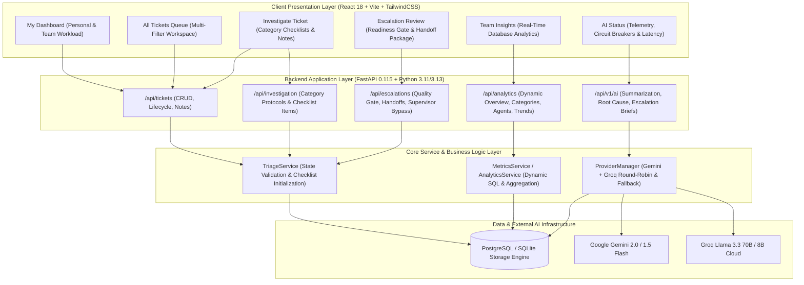
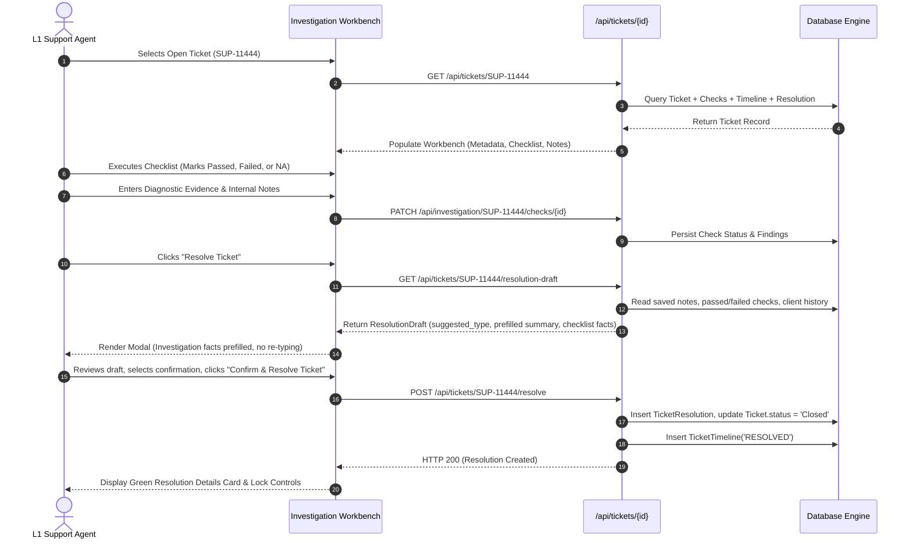
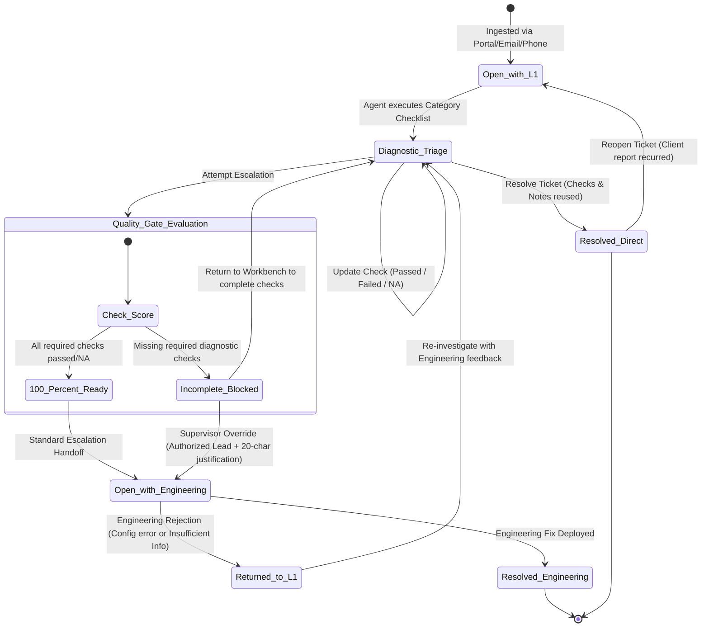
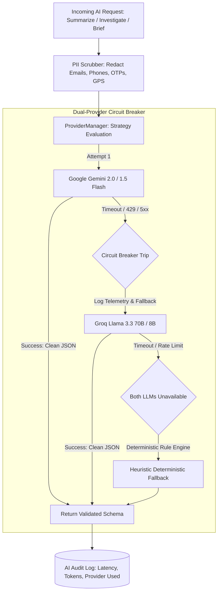
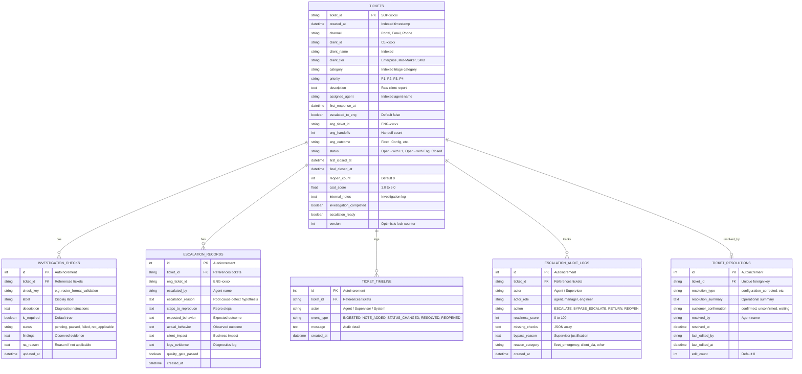

# SupportDesk Architecture & System Design

SupportDesk is designed as a modular, high-throughput triage and operational intelligence system built with FastAPI, PostgreSQL/SQLite, React 18, and rotated multi-provider LLM infrastructure.

---

## 1. High-Level System Architecture

---

## 2. Smart Ticket Resolution Workflow

The resolution workflow reuses all facts, checklist outcomes, and notes recorded during investigation to avoid re-keying data:

---

## 3. Escalation State Machine & Quality Gate Verification

---

## 4. Multi-Provider AI Fallback & Observability

---

## 5. Entity-Relationship Data Model (ERD)

