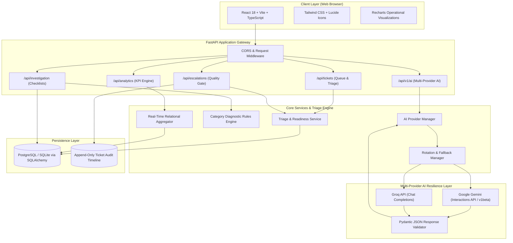

# SupportDesk Architecture & System Design

SupportDesk is an intelligent support operations platform designed to solve the **Escalation-Rejection Doom Loop** at RideOps without requiring additional headcount.

---

## 1. High-Level System Architecture

---

## 2. Component Design & Responsibilities

### A. Operations Command Center
- **Purpose:** Gives Meera (Support Lead) and Ritika (Head of Ops) immediate visibility into the true root causes of support backlog.
- **Key Metrics:** Live active backlog, engineering escalation rate, escalation bounce rate, mean resolution hours by handoff type, CSAT distribution.
- **Evidence-Based:** Directly calculates metrics from database rows; no hardcoded statistics.

### B. Ticket Queue & Workspace
- **Purpose:** High-density, fast-filtering workspace for L1 support agents.
- **Capabilities:** Server-side pagination, search by Ticket ID, Client, or Description, multi-dimensional filters (Category, Priority, Status, Agent, Tier, Escalated Only).

### C. Investigation Workbench & Category Protocols
- **Purpose:** Guides L1 support through standardized preliminary checks before any ticket can be escalated.
- **Domain Protocols:**
  - *Roster / booking not syncing:* Checks template headers, shift cutoff window, SFTP sync status.
  - *Live tracking / GPS incorrect:* Checks device telematics ping recency, location permissions, OBD hardware vs mobile app fallback.
  - *Report export failing:* Checks 90-day synchronous limits, portal permissions, filter criteria.

### D. Escalation Quality Gate
- **Purpose:** Validates that tickets meet Sandeep's engineering triage standards before handoff.
- **Readiness Scoring:** Computes completion percentage and blocks incomplete submissions unless an explicit, audited manager bypass justification is provided.

### E. Multi-Provider AI Resilience Layer
- **Architecture:** Concurrent round-robin rotation across Google Gemini (`gemini-3.8-flash`) and Groq (`openai/gpt-oss-120b`).
- **Resilience:** Automatic 5xx/429 failure detection, temporary provider cooldowns, failover routing, and Pydantic schema validation.
